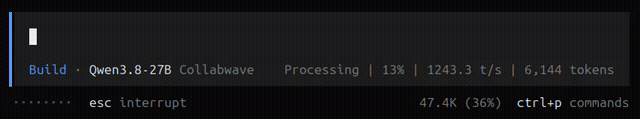
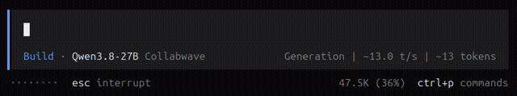

# oc-pulse

Real-time LLM inference metrics visualization for OpenCode.

## Purpose

Designed for AI researchers and developers using self-hosted inference servers. See generation speed and progress in real-time while waiting for LLM responses in OpenCode.

## Demo

**Prompt processing (prefill phase)** — progress and processing speed while the prompt is being processed:



**Generation and processing** — generation speed and token counts in real-time:



## Architecture

This plugin works with **llama-swap-pulse**, a companion server that:
- Reads logs from your llama-swap instance
- Exposes metrics via HTTP API and Server-Sent Events (SSE)
- Provides real-time inference data in a plugin-friendly format

The plugin automatically connects to the pulse server based on your provider's `baseURL` configuration.

## Install

Add to your `~/.config/opencode/cli.json`:

**From npm:**
```json
{
  "plugins": [
    { "package": "oc-pulse", "options": { "port": 8090, "debug": true } }
  ]
}
```

**From local file:**
```json
{
  "plugins": [
    { "package": "file:///path/to/oc-pulse", "options": { "port": 8090, "debug": true } }
  ]
}
```

> oc-pulse 2.x requires OpenCode 2.x. For OpenCode 1.x use oc-pulse 1.x registered in `tui.json`.

## Options

| Option | Type | Default | Description |
|--------|------|---------|-------------|
| `port` | `number` | `8090` | Pulse server port. If omitted, defaults to `8090`. |

## How it works

- Reads the current session's provider `baseURL` automatically
- Strips path components (e.g. `/v1`, `/openai`) and uses host + port
- Displays LLM metrics in the session prompt area
- Automatically reconnects when switching providers

## Metrics

Live metrics are displayed in the right side of the session prompt:

### Prefill Phase (prompt processing)
- Progress percentage
- Processing speed (tokens/sec)
- Number of prompt tokens

### Generation Phase (response generation)
- Generation speed (tokens/sec)
- Number of tokens generated
- Engine semantic status (Strata/Maya engines only): `Thinking` while the model
  reasons, `Tool call` while it writes a tool call — shown instead of `Generation`
  (e.g. `Thinking | 94.5 t/s | 132 tokens`)

### Completed Tasks
- Total duration
- Total tokens (prompt + generated)

### Additional Info
- Graph cache reuse count (when available)
- Model restoration similarity score (when restoring cached context)

**Status indicators:**
- `◯` — Connected but no task running
- `✕` — Pulse server running but disconnected from llama-swap
- `(empty)` — Inactive (no session or no baseURL)

## Requirements

- OpenCode >= 1.14.31
- A provider with a `baseURL` configured (e.g., a llama-swap instance)
- **llama-swap-pulse** running on your llama-swap server

  Install and configure: https://github.com/LeBohdan/llama-swap-pulse

Providers without `baseURL` (e.g., OpenRouter, API-key providers) will show `inactive` state.

---

## Copyright

(c) Bohdan Futerko, 2026, [https://www.bf.com.ua](https://www.bf.com.ua), [https://github.com/LeBohdan](https://github.com/LeBohdan)
